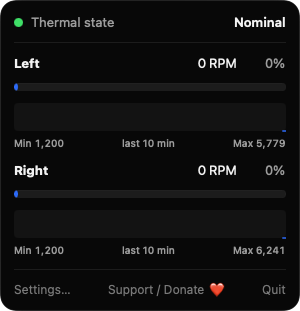
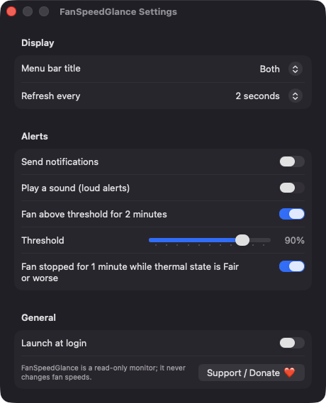

# FanSpeedGlance

**🌐 Website:** [turhe123.github.io/fan-speed-glance](https://turhe123.github.io/fan-speed-glance/)

A menu bar readout of every fan's RPM with a short history sparkline and quiet or loud alerts.

> 🆓 A free, open-source **Macs Fan Control Pro alternative** for macOS 14+. Native Swift, no accounts, no subscriptions, MIT licensed.


## Why

FanSpeedGlance is a free, open-source, 100% native, backend-free alternative to paid utilities in the *System Monitoring* category. It was inspired by tools like Macs Fan Control Pro ($14.95 one-time), a well-regarded app. FanSpeedGlance is deliberately narrower: it is a read-only monitor that shows what your fans are doing and warns you about unusual behavior. It never writes fan speeds, has no helper tool, and talks to no server.

## Features

- **Menu bar readout** of the highest fan RPM, a fan glyph, or both (your choice). RPM is rounded to the nearest 10 and uses fixed-width digits so the status item doesn't jiggle.
- **Every fan listed** in the popover (named Left/Right on two-fan Macs, otherwise Fan 1, Fan 2, …) with current RPM, percent of maximum, a gauge, and the fan's minimum and maximum RPM.
- **Ten-minute sparkline** per fan, kept in memory only.
- **System thermal state** (Nominal, Fair, Serious, Critical) with a colored dot.
- **Two optional alerts**:
  - A fan stays above a chosen percent of its maximum (50–100%, default 90%) for over two minutes.
  - A fan that should be spinning reads 0 RPM for a minute while the thermal state is Fair or worse.
  - Alerts only start timing after two consecutive qualifying samples, so brief spikes after wake stay quiet.
- **Quiet or loud**: notifications are off by default; an optional sound makes alerts loud.
- **Refresh interval** of 1, 2 or 5 seconds. Polling pauses when the popover is closed and nothing else needs live data.
- **Launch at login** via `SMAppService`.
- **Graceful edge cases**: fanless Macs (e.g. MacBook Air) show "This Mac has no fans" plus the thermal state; if the SMC can't be opened you get a clear "Fan sensors unavailable" message; implausible readings (negative or over 20,000 RPM) are discarded and the previous value is kept.
- **Keyboard shortcuts**: ⌘, for Settings, ⌘Q to quit.
- A visible **Support / Donate ❤️** button in the popover and in Settings.

## Screenshots

<p align="center"></p>

<p align="center"><em>The menu bar popover shows the system thermal state and each fan&#x27;s live RPM, percent of maximum, gauge, min/max range and a ten-minute history sparkline.</em></p>

<p align="center"></p>

<p align="center"><em>Settings let you choose the menu bar title style and refresh rate, configure high-speed and stopped-fan alerts, and enable launch at login.</em></p>

## Install

1. Download `FanSpeedGlance-macOS.zip` from the [latest release](https://github.com/turhe123/fan-speed-glance/releases/latest).
2. Unzip it and move `FanSpeedGlance.app` to `/Applications`.
3. Because the app is open source and not notarized, clear the quarantine attribute:

   ```bash
   xattr -cr /Applications/FanSpeedGlance.app
   ```

4. The first time, right-click the app and choose **Open**.

## Build from source

Requires macOS 14+ and Xcode with Swift 5.9+.

```bash
brew install xcodegen
xcodegen generate
xcodebuild -project FanSpeedGlance.xcodeproj -scheme FanSpeedGlance -configuration Release -derivedDataPath ./build build
```

The app is produced at `build/Build/Products/Release/FanSpeedGlance.app`.

## Permissions

FanSpeedGlance asks for very little:

- **Notifications** (optional): requested only when you turn on "Send notifications", so alerts can be delivered. If you decline, the app works normally without alerts.
- **Login item** (optional): only if you enable "Launch at login".
- **No Accessibility, Screen Recording, or Microphone access** is requested, and no root privileges are needed. Fan speeds are read with read-only calls to the AppleSMC service through IOKit.

## Built with AI

FanSpeedGlance was written by [Claude Code](https://claude.com/claude-code) inside an automated pipeline, from a plain-English spec. No code, binaries or assets from any commercial app were used; it is a clean-room reimplementation of a feature set, not a copy.

What that means in practice:

- The full source is in this repo under the MIT license. Read it before you run it.
- No network calls, no analytics, no third-party dependencies. Only Apple frameworks.
- Ad-hoc signed and not notarized, which is why Gatekeeper warns on first launch.
- It has had less human review than a hand-written app. Bug reports and pull requests are welcome.

## Support ❤️

If FanSpeedGlance is useful to you, you can support its development:

[Support Or (Leo) Davidai ❤️ on Ko-fi](https://ko-fi.com/leodavidai)

## More free Mac apps

FanSpeedGlance is one of a growing collection of [free, open-source Mac utilities](https://github.com/turhe123/mac-apps) built the same way: native Swift, no accounts, no telemetry. Browse the full gallery at [turhe123.github.io/mac-apps](https://turhe123.github.io/mac-apps/).

Prefer something that runs in the browser? The same pipeline builds [free, private web tools](https://turhe123.github.io/web-tools/): PDF, image, developer, data and audio tools, nothing uploaded.

## License

MIT © Or Davidai Bachar
